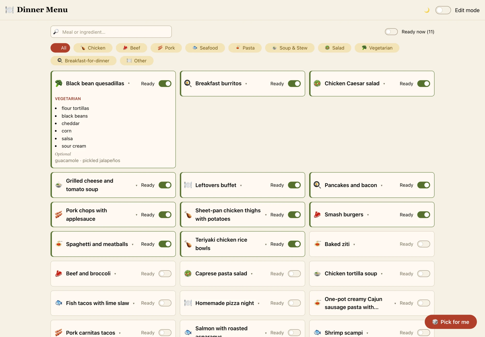
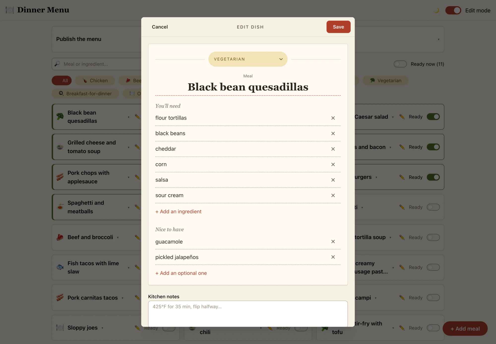
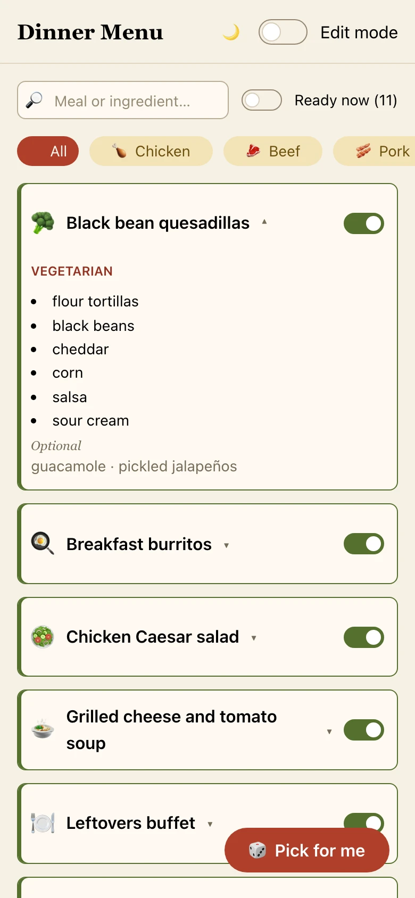
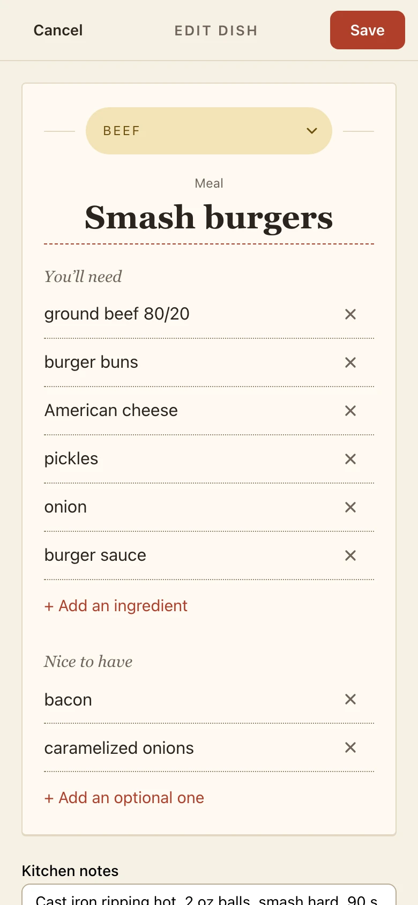
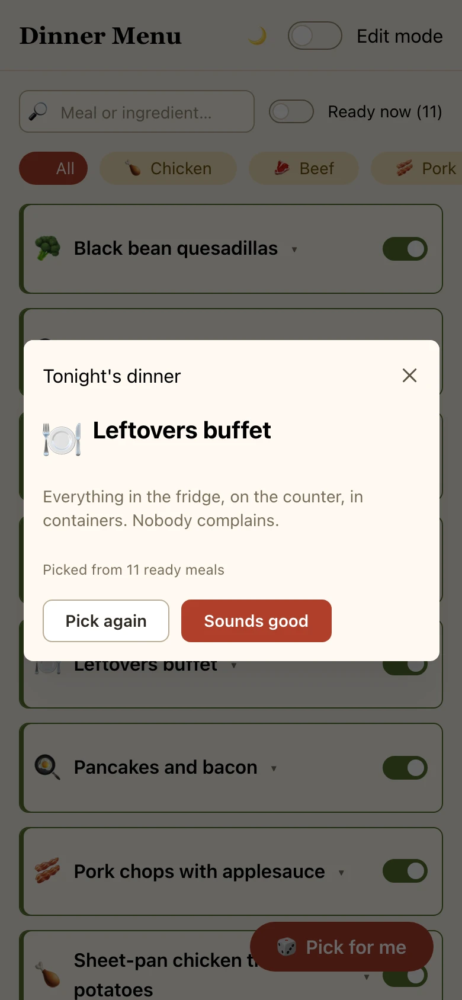

# Dinner Menu

A personal household web app: a visual library of the meals we know how to make.
Browse, search, and filter — and flip a per-meal switch for "I have everything to
make this right now." Works on laptop, phone, and iPad.

**Live:** [dinner-menu.nineafterten.com](https://dinner-menu.nineafterten.com). The
screenshots show the made-up sample menu in `dev/sample-menu.json`.

<picture>
  <source media="(prefers-color-scheme: dark)" srcset="docs/screenshots/menu-dark.webp">
  
</picture>

## Screens

**Add or edit a meal.** The form is laid out like the menu entry it becomes: a category
tag, the name set large, one line per ingredient, and a "Nice to have" list for the
optional ones.

<picture>
  <source media="(prefers-color-scheme: dark)" srcset="docs/screenshots/form-dark.webp">
  
</picture>

**On a phone.** Cards stack in one column, the form fills the screen, and **Pick for me**
chooses tonight's dinner from the meals that are ready.

<p>
<picture>
  <source media="(prefers-color-scheme: dark)" srcset="docs/screenshots/phone-menu-dark.webp">
  
</picture>
<picture>
  <source media="(prefers-color-scheme: dark)" srcset="docs/screenshots/phone-form-dark.webp">
  
</picture>
<picture>
  <source media="(prefers-color-scheme: dark)" srcset="docs/screenshots/phone-pick-dark.webp">
  
</picture>
</p>

## Stack

- **React + Vite + Mantine** (a printed-menu palette: cream paper by day, a candlelit dark
  theme by night, following the device unless the header menu says otherwise), a 50s-diner
  wordmark drawn as SVG from Yellowtail, and [Lucide](https://lucide.dev) icons
- **localStorage** on each device, seeded from **`public/menu.json`**, which ships with the
  site. There is no backend.

## Run locally

```bash
npm install
npm run dev
```

`dev/sample-menu.json` holds 24 made-up meals for trying the UI. Load it with **Import a
file…** in Entry mode. It isn't published, so never copy it over `public/menu.json`.

## Publishing the menu

Every device shows the menu published with the site, `public/menu.json`. To change it:

1. Turn on **Entry mode** in the header menu (☰) and make your changes.
2. Choose **Export menu.json** in the *Publish the menu* panel.
3. Replace `public/menu.json` in the repo with the exported file, commit, and push. The
   site redeploys in about a minute.

A device picks up a newly published menu when it has no meals yet, or when it follows the
published menu and no meal on it has been edited since that menu was exported. Flipping a
Ready switch isn't an edit, so the next published menu replaces those flips. A device keeps
its own copy instead when it already had meals before `menu.json` existed, or after
**Import a file…**. **Use the published menu** puts it back on the published one.

## How it works

- **The header menu** (☰) holds the **Ready now**, **Favorites** and **Tag** filters,
  **Entry mode**, the theme and **About** (version and build). A dot on the menu button
  shows while a filter is on.
- **Favorites** are the hearts on the cards. Each device keeps its own, apart from the
  meals (`dinner-menu:favorites`), so a published menu never changes them.
- **Entry mode** reveals the add/edit controls and the publish panel. It's a soft,
  no-auth convention — turn it on only on your own devices. The ready switches work
  without it.
- **Cards** show one line per meal; tap one for its ingredients, tags, and prep and cook steps. Ready meals
  sort first, a line above them counts what the filters show, and **Pick for me**
  chooses at random among the ready meals that match the current filters.
- **Data model:** name, optional category (with a line icon), the ingredients a meal
  needs, `optionalIngredients` (nice to have), `tags` (free-form, such as who a meal is
  for), `prep` and `cook` steps, and the `ready` boolean. Older meals may lack the newer
  fields; their one `notes` field reads as `cook` and moves there when the meal is saved.
- **The add/edit form** is laid out like the menu entry it becomes. Enter starts the
  next ingredient line, Backspace on an empty line removes it, and pasting several
  lines splits them into rows, and each line suggests ingredients already on the menu.
  **Duplicate this meal** turns the edit form into a new
  dish with the same details, its name selected for renaming.
- The data layer lives in [`src/data/`](src/data): `localRepository.js` reads and writes
  this device's copy, and `menuFile.js` handles export, import, and `menu.json`.

## Deploy

Live at <https://dinner-menu.nineafterten.com>, built and served by Cloudflare from GitHub on
every push to `main`. See [`DEPLOY.md`](DEPLOY.md).
